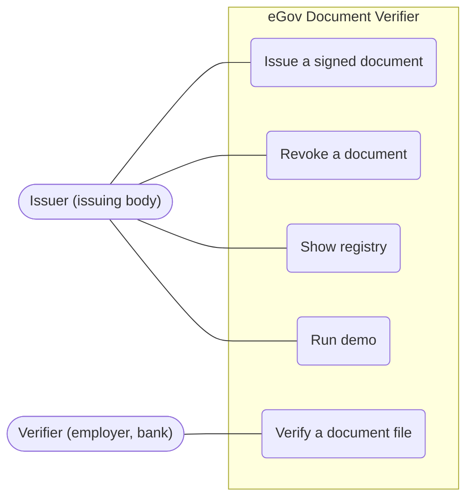
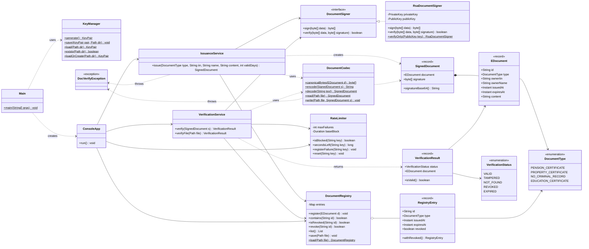
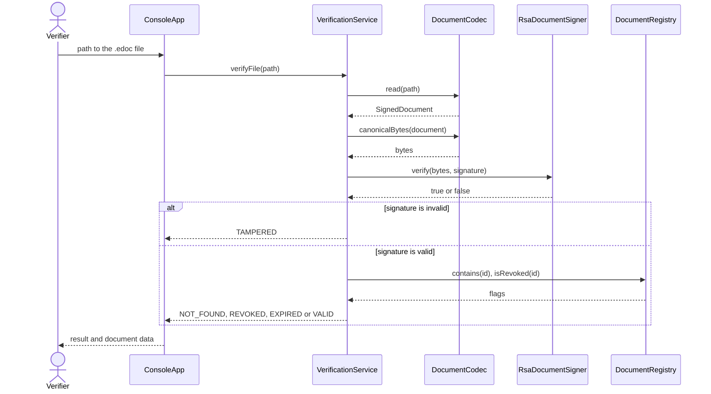
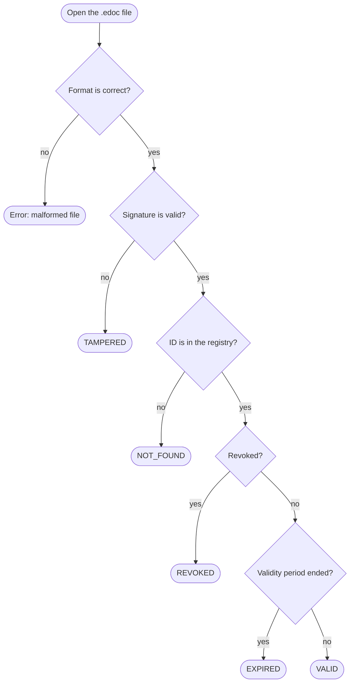
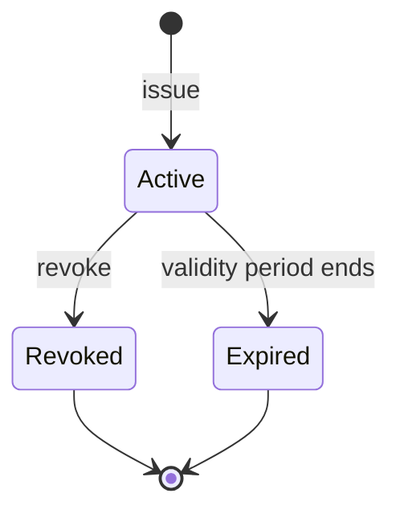

# UML диаграммалары

Диаграммалар Mermaid форматында жазылған: GitHub олардың суретін автоматты түрде көрсетеді.
Есепке сурет керек болса, кодты [mermaid.live](https://mermaid.live) сайтына қойып, PNG етіп жүктеп алуға болады.

## 1. Use Case диаграммасы

Құжат иесі (азамат) файлды берушіден алып, тексерушіге көрсетеді. Бұл қадам жүйеден тыс өтеді, сондықтан диаграммада жоқ.

## 2. Класс диаграммасы

## 3. Sequence диаграммасы: құжатты тексеру

## 4. Activity диаграммасы: тексеру алгоритмі

## 5. Құжаттың өмірлік циклі (State диаграммасы)

`Expired` күйі тізілімде сақталмайды: ол тексеру кезінде ағымдағы уақыт бойынша есептеледі.
