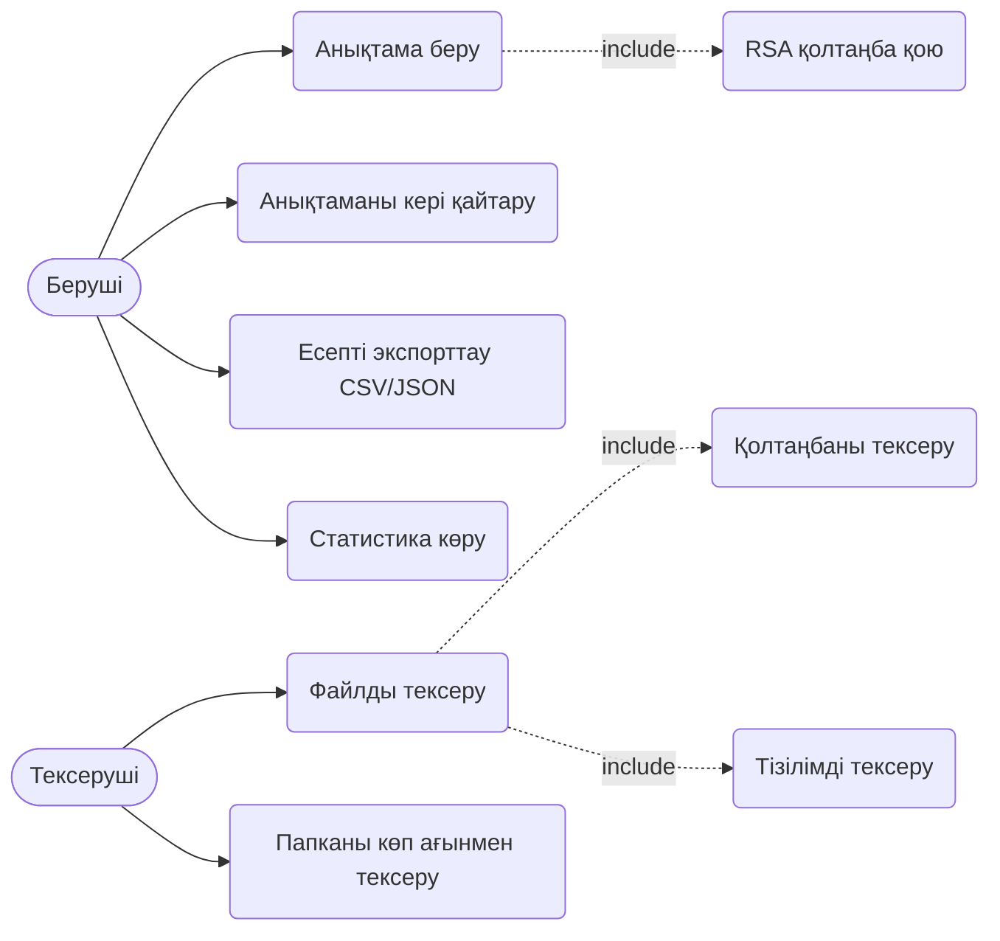
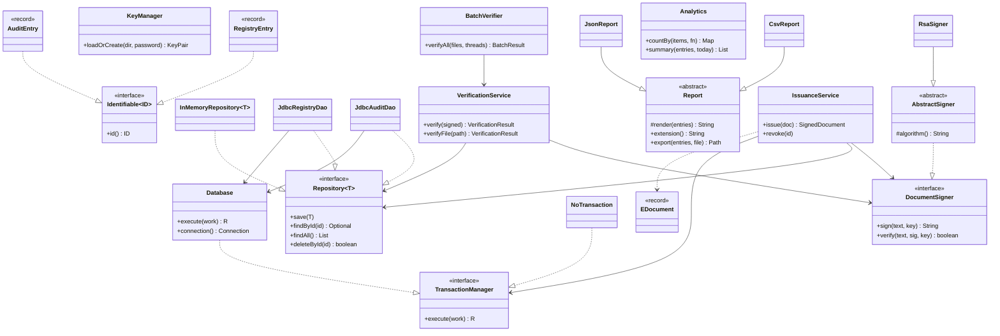
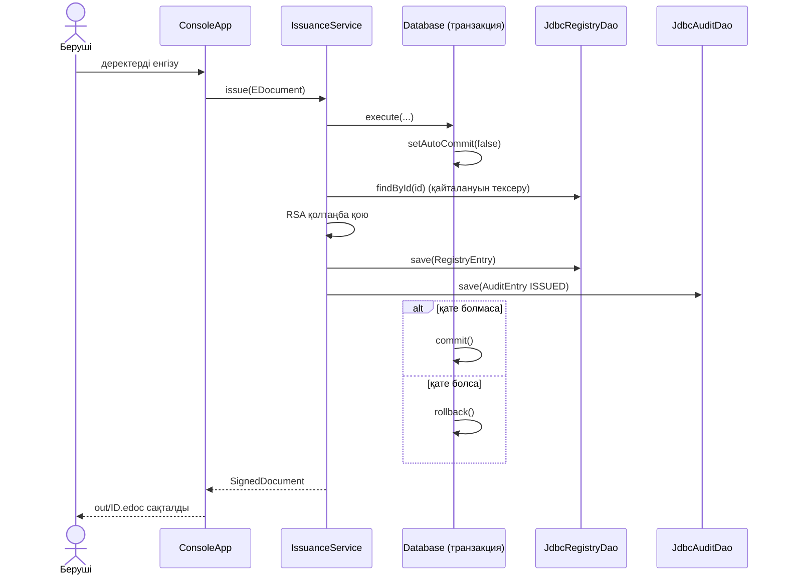
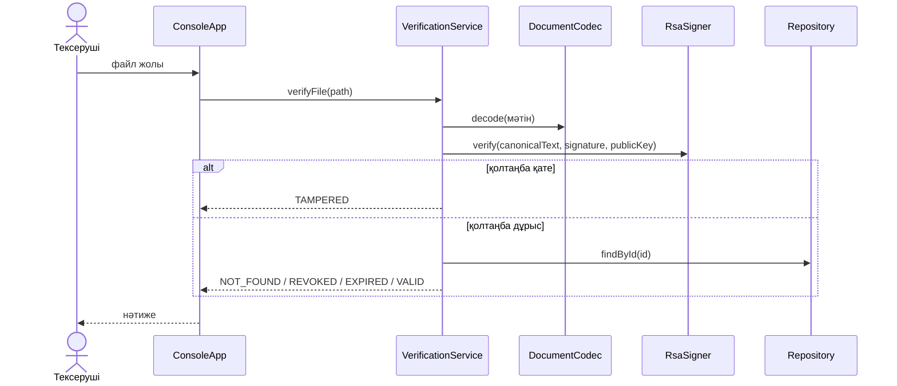
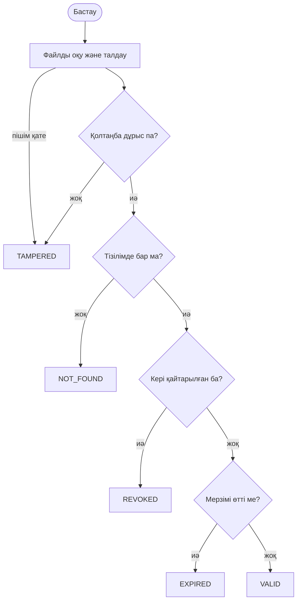
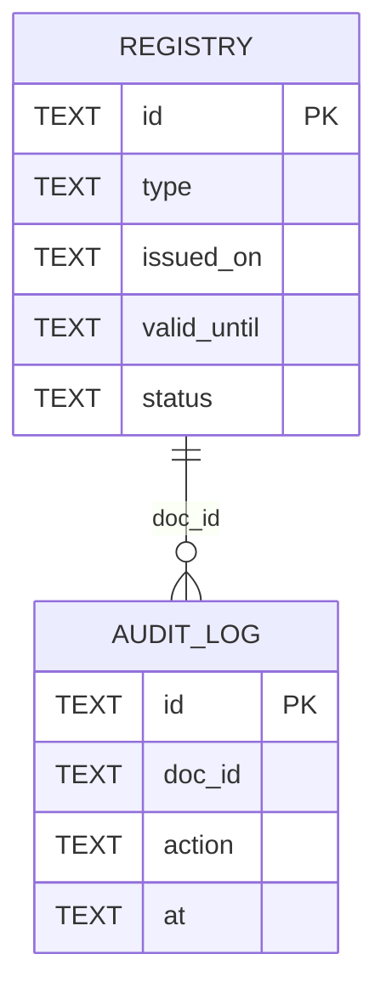

# UML диаграммалары

## 1. Use Case

## 2. Class diagram

## 3. Sequence: анықтама беру (транзакциямен)

## 4. Sequence: файлды тексеру

## 5. Activity: тексеру алгоритмі

## 6. ER диаграммасы (SQLite)

